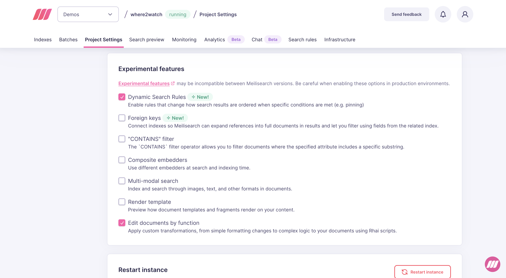

<Note>
This page is for Meilisearch Cloud users. If you self-host Meilisearch, see [how to enable experimental features for self-hosted instances](/resources/help/experimental_features_overview).
</Note>

Meilisearch occasionally ships features in an experimental state before promoting them to stable. Experimental features are fully functional but their API or behavior may change between Meilisearch versions without a deprecation period. Be careful when enabling them in production environments.

You can enable or disable experimental features per project from **Project Settings > General**.

<Frame>
  
</Frame>

Check the box next to a feature to enable it. Changes take effect immediately without a restart or re-index.

## Available features

The list depends on your project's Meilisearch version. A feature appears only if your version supports it.

| Feature | Description |
|---------|-------------|
| **MCP server** | Expose your Meilisearch index through a [Model Context Protocol (MCP) server](/getting_started/integrations/mcp) for use with AI agents and tools |
| **Dynamic Search Rules** | [Pin, boost, deboost, or hide documents](/capabilities/search_rules/overview) in search results when specific conditions are met. Requires Meilisearch v1.41 or later |
| **Foreign keys** | [Connect indexes](/capabilities/indexing/joins/define_index_relationships) so Meilisearch can expand references into full documents in results, and filter using fields from a related index |
| **"CONTAINS" filter** | Adds the [`CONTAINS` filter operator](/capabilities/filtering_sorting_faceting/advanced/filter_expression_syntax#contains) to match documents where the specified attribute includes a specific substring |
| **Composite embedders** | Use [different embedders](/capabilities/hybrid_search/advanced/composite_embedders) at search time and indexing time |
| **Multi-modal search** | [Index and search through images](/capabilities/hybrid_search/how_to/image_search_with_multimodal), text, and other formats in documents |
| **Render template** | Preview how document templates and fragments render on your content |
| **Edit documents by function** | [Apply custom transformations to documents](/capabilities/indexing/how_to/edit_documents_with_functions) using Rhai scripts, from simple formatting changes to complex logic |

## Other experimental features

Meilisearch could have more experimental features than the ones listed on this page. For the complete list, see the [experimental features overview](/resources/help/experimental_features_overview).

If you need an experimental feature that is not available in your project settings, contact [support@meilisearch.com](mailto:support@meilisearch.com).

## Stability notice

Experimental features are not covered by the standard API stability guarantee. If you rely on one in production, monitor the [changelog](/changelog) for changes or promotion to stable.
