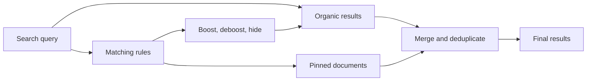

Search rules run on top of organic search. Meilisearch still ranks your documents as usual, then applies the actions of every matching rule.

1. Computes the organic results for the query
2. Applies boost, deboost, and hide to the relevancy of the selected documents, which changes their order. Hidden documents leave the result set
3. Inserts the pinned documents at the positions set in the rule
4. Removes duplicates and returns the final result set

Pinning and relevancy are independent: a pinned document keeps its position whatever its relevancy, while boosted and deboosted documents stay organic and only move up or down.
