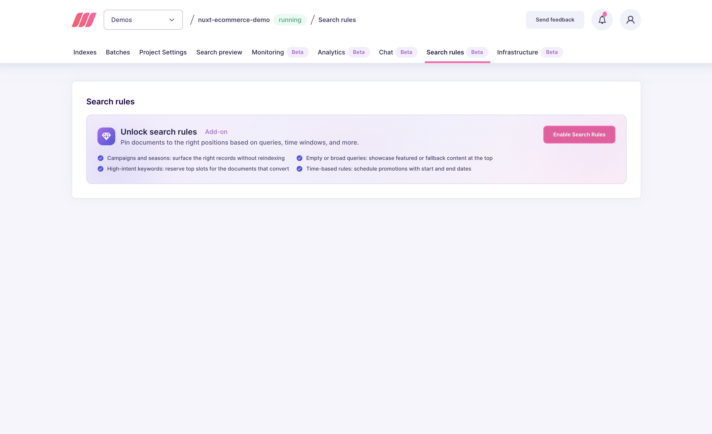
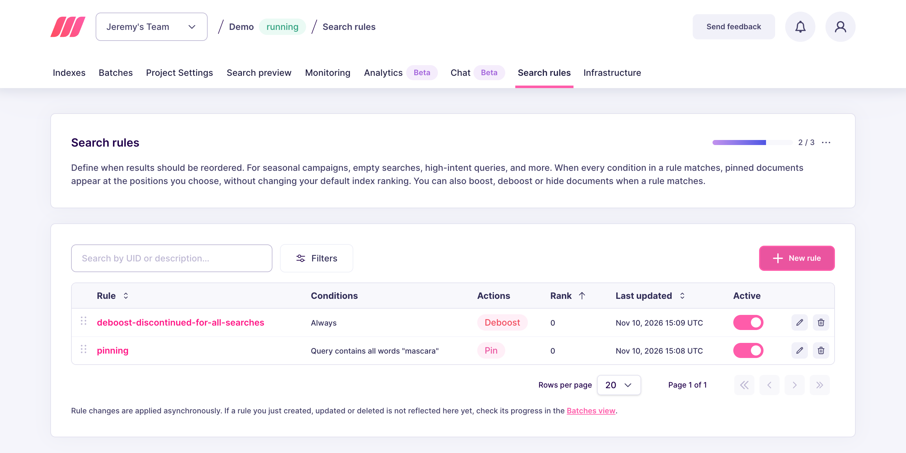
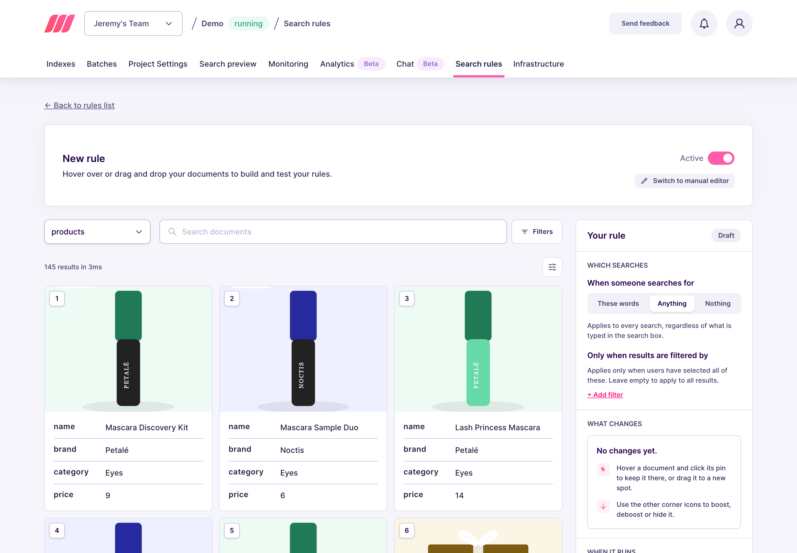
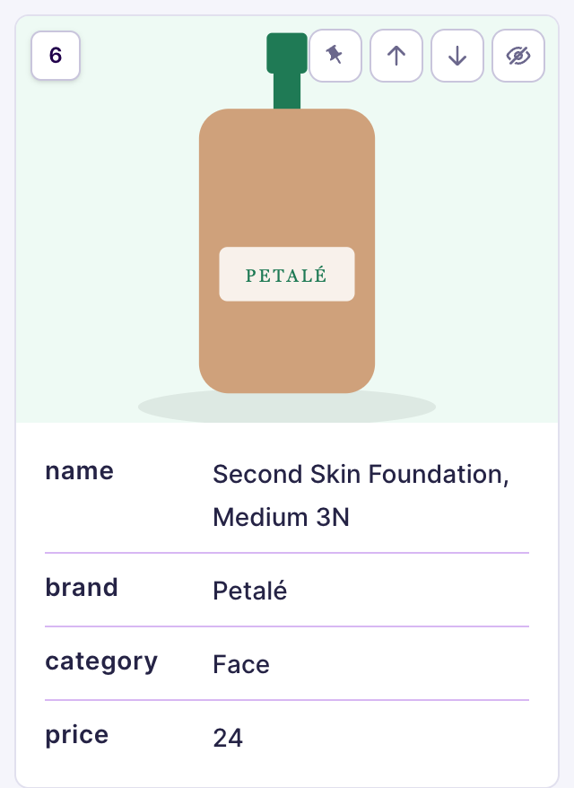
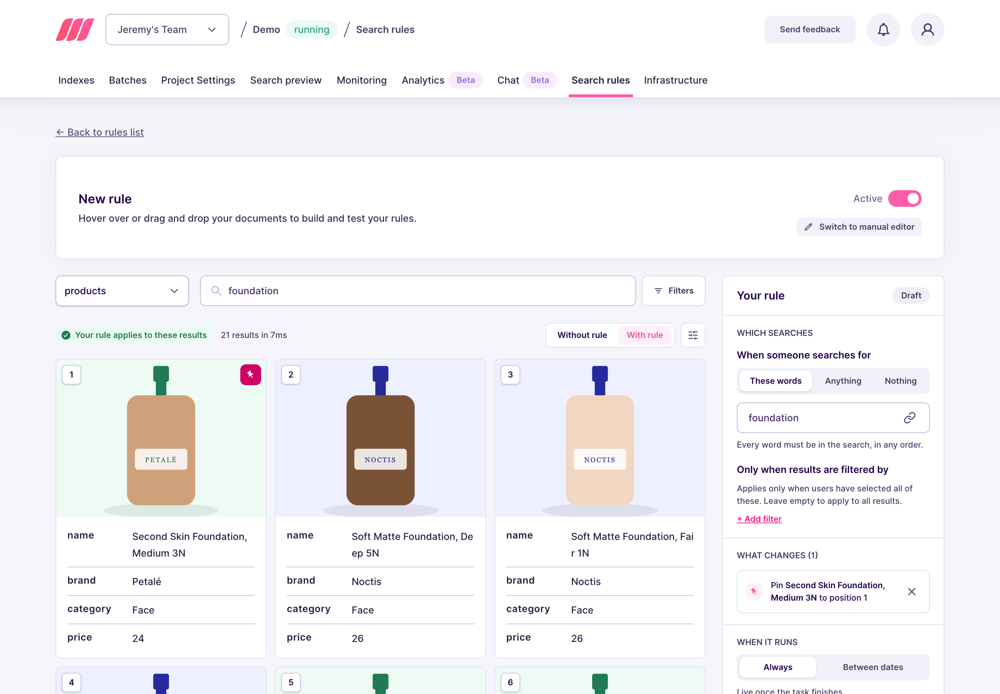
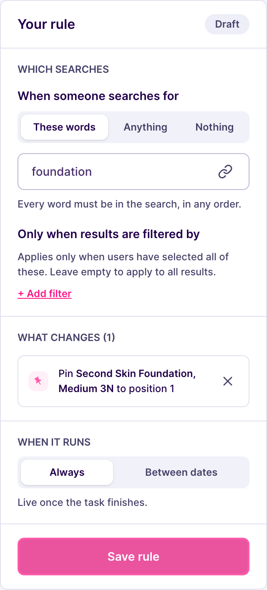
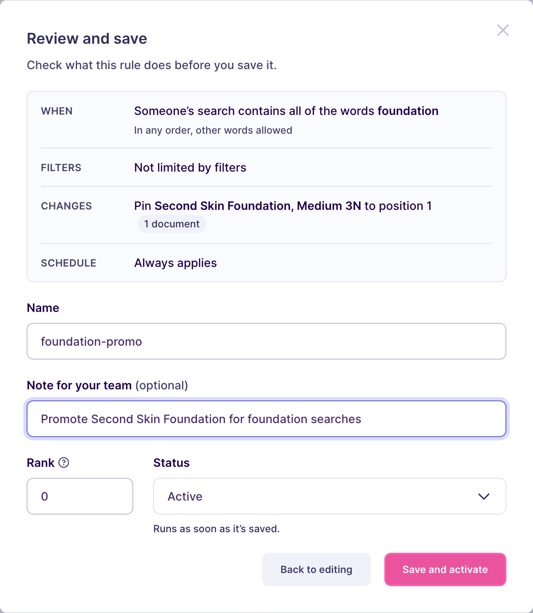
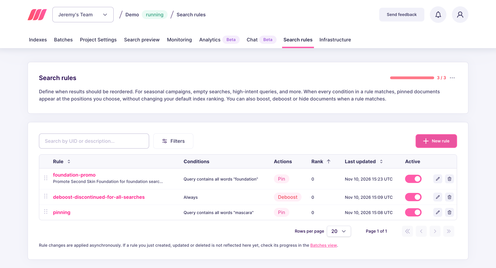

import CodeSamplesSearchRulesGuideEnable1 from '/snippets/generated-code-samples/code_samples_search_rules_guide_enable_1.mdx';
import CodeSamplesSearchRulesGuideCreateRule1 from '/snippets/generated-code-samples/code_samples_search_rules_guide_create_rule_1.mdx';
import CodeSamplesSearchRulesGuideGetRule1 from '/snippets/generated-code-samples/code_samples_search_rules_guide_get_rule_1.mdx';
import CodeSamplesSearchRulesGuideSearch1 from '/snippets/generated-code-samples/code_samples_search_rules_guide_search_1.mdx';

This guide shows you how to turn on Search Rules and build your first rule: pin one document to the top of your search results.

## Set up from the Meilisearch Cloud dashboard

Open your project in the [Meilisearch Cloud dashboard](https://cloud.meilisearch.com) and select the **Search rules** tab.

### Turn on Search Rules

Click **Enable Search Rules**. Your project can now store rules and apply them at search time.



### Open the visual editor

Click **New rule**.



The visual editor opens. You build the rule on your real documents:

- On the left, a preview of your search results. Choose the index and type a search, as your users would.
- On the right, the **Your rule** panel. It shows which searches trigger the rule and what the rule changes.



<Note>
The visual editor requires Meilisearch v1.55 or newer. On older versions, **New rule** opens the manual editor. To use the manual editor on a newer version, click **Switch to manual editor**.
</Note>

### Choose which searches trigger the rule

In the **Which searches** section, choose when the rule runs:

- **These words**: the search must contain every word you enter, in any order. Other words are allowed.
- **Anything**: the rule runs on every search, whatever the user types.
- **Nothing**: the rule runs only when the search box is empty.

For this first rule, select **These words**, then type `foundation` in the search bar. The search words in the panel follow the search bar, so the preview always shows the results your rule changes. To enter different words in the panel, click the link icon in the search words field to unlink it.

To limit the rule to filtered searches, click **Add filter**. The rule then runs only when users filter the results by all of these values. Leave the filters empty for this first rule.

### Pin a document

Hover a result card to show its icons: pin, boost, deboost, and hide.



You can pin a document in two ways:

- Drag its card onto another card. The document takes that position.
- Click its pin icon. The document keeps its current position.

Drag the document you want to promote onto the first card. It moves to position 1 and shows a filled pin. The message **Your rule applies to these results** confirms that your rule changes this search. To compare, switch between **Without rule** and **With rule**.



Meilisearch pins this exact document, using its primary key. It does not pin documents that look similar. The document stays at this position every time the rule matches, even when it does not match what the user typed. The rule applies only to searches on the index you chose.

### Save the rule

The **Your rule** panel now lists the pin in the **What changes** section. In **When it runs**, keep **Always**. To run the rule during a campaign, select **Between dates** instead.



Click **Save rule**. The **Review and save** dialog shows what the rule does. Fill in the fields:

| Field | What it does |
|-------|--------------|
| **Name** | The unique identifier of the rule. You cannot change it after you save the rule |
| **Note for your team** | Optional free text, so your team knows why the rule exists |
| **Rank** | Decides which rule wins when several rules match the same search. The lowest number wins |
| **Status** | **Active** applies the rule as soon as you save it. **Inactive** saves the rule without applying it |



Click **Save and activate**.

Your rule is now live: every time a user searches for `foundation` on your index, the document you pinned appears first. All the other results remain organic.

### Review and manage your rules

The Search rules tab lists every rule with its conditions, actions, rank, and last update. Search the list by rule ID or description, use the row toggle to pause a rule without deleting it, or the icons on the right to edit or remove it. Editing a rule opens it in the visual editor.



Rule changes are applied asynchronously, so a rule you just created, updated, or deleted can take a moment to appear in the list.

## Set up on a self-hosted instance

### Turn on Search Rules

<CodeSamplesSearchRulesGuideEnable1 />

Until you turn on Search Rules, the `/dynamic-search-rules` routes reject your requests and stored rules do not apply at search time.

### Create a rule

<CodeSamplesSearchRulesGuideCreateRule1 />

This rule means: every time a user searches the `support` index with a query containing the word `invoice`, the document `billing-workspace-overview` appears at the first position of the results.

- The rule identifier comes from the URL, here `invoice-help`. The body does not contain it.
- `precedence` decides which rule wins when several rules match the same search. The lowest number wins.
- `conditions.query.words` makes the rule run only when every word it contains appears in the query, in any order.
- `actions.pin.indexUid` limits the rule to searches on the `support` index. Without it, the rule applies to any index that contains a document with this ID.
- `actions.pin.position` counts from `0`, so `0` is the first result. The dashboard displays the same slot as position `1`.

Meilisearch answers with a summarized task containing a `taskUid`, because creating a rule is an [asynchronous operation](/capabilities/indexing/tasks_and_batches/async_operations). The rule only applies to searches once this task reaches the `succeeded` status. To follow its progress, pass the `taskUid` to the [task API](/reference/api/tasks/get-task).

For the full list of conditions and actions a rule accepts, see the [Search Rules API reference](/reference/api/search-rules/create-or-update-a-search-rule).

### Check the stored rule

<CodeSamplesSearchRulesGuideGetRule1 />

Meilisearch returns the rule as it stored it:

```json
{
  "uid": "invoice-help",
  "description": "Promote billing help for invoice searches",
  "lastUpdatedAt": "2026-10-20T09:25:53.965008429Z",
  "precedence": 0,
  "active": true,
  "conditions": {
    "query": {
      "words": "invoice"
    }
  },
  "actions": {
    "pin": [
      {
        "indexUid": "support",
        "id": "billing-workspace-overview",
        "position": 0
      }
    ]
  }
}
```

If Meilisearch answers that the rule does not exist, the creation task is probably still in progress. Wait a few moments, then try again.

### Run a search

<CodeSamplesSearchRulesGuideSearch1 />

The document `billing-workspace-overview` comes back first, followed by your organic results. If the document does not exist, or if the search filters exclude it, Meilisearch drops the pin and returns the organic results only.

## Next steps

<CardGroup cols={2}>
  <Card title="Boost documents" href="/capabilities/search_rules/how_to/boost_documents">
    Rank a selection of documents higher during a campaign
  </Card>
  <Card title="Hide documents" href="/capabilities/search_rules/how_to/hide_documents">
    Remove documents from the results without reindexing
  </Card>
  <Card title="How Search Rules work" href="/capabilities/search_rules/advanced/how_search_rules_work">
    See how Meilisearch builds the final result set
  </Card>
  <Card title="API reference" href="/reference/api/search-rules/create-or-update-a-search-rule">
    Endpoints, rule fields, and update behavior
  </Card>
</CardGroup>
