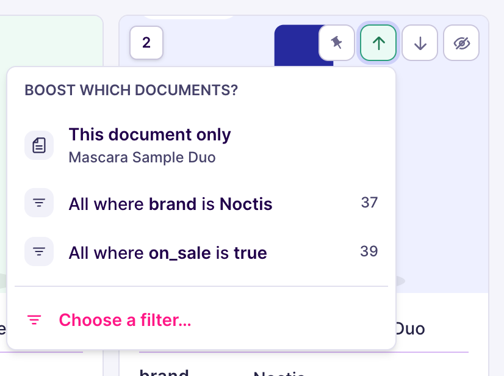
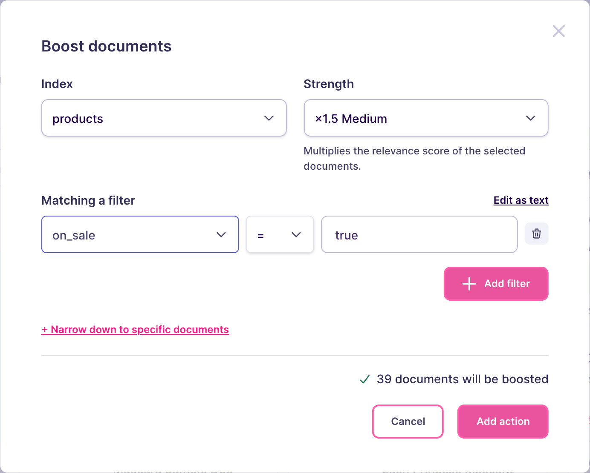
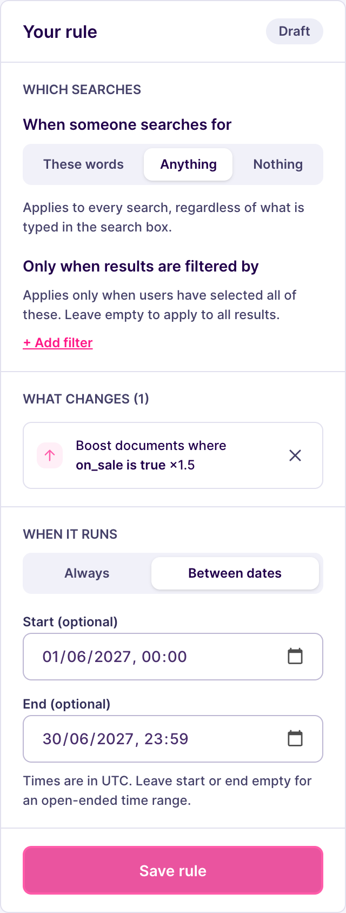

import CodeSamplesSearchRulesGuideBoost1 from '/snippets/generated-code-samples/code_samples_search_rules_guide_boost_1.mdx';

Your summer sale runs from June 1 to June 30. During that month, you want every product on sale to rank higher than the rest, whatever users type. Pinning is too rigid here: you do not know in advance which products users will search for, and you do not want a fixed list at the top of every result page. Boosting keeps the results organic and only pushes the selected products up.

One rule covers the whole campaign: a time condition for the period, and a boost action for the products on sale.

## Set up from the Meilisearch Cloud dashboard

Open your project in the [Meilisearch Cloud dashboard](https://cloud.meilisearch.com), select the **Search rules** tab, and click **New rule**. The visual editor opens. For a walkthrough of the editor, see [Create your first rule](/capabilities/search_rules/create_your_first_rule).

Choose the index, here `products`. In the **Your rule** panel, keep **Anything** selected, so the rule applies whatever users type.

### Boost the products on sale

Hover any result card, then click its boost icon. The menu asks which documents to boost:

- **This document only**: boosts the document on the card.
- **All where…**: boosts every document sharing a value with this card, such as its brand or its category. The menu shows how many documents each option selects.
- **Choose a filter…**: boosts the documents matching a filter you write.



A filter fits here, because you want every product on sale, whichever they are at that moment. When you open the menu on a product on sale, it can suggest **All where on_sale is true**, which selects them in one click. Otherwise, click **Choose a filter…**, then fill in the dialog:

- **Index**: the index holding the products, here `products`.
- **Strength**: how high the selected products climb. Start with **Medium**, then run a few searches of your own and adjust: the right strength depends on your data and on the way your users search.
- **Matching a filter**: the condition selecting the products, here `on_sale = true`. The attribute you filter on must be in the [`filterableAttributes` setting](/reference/api/settings/get-filterableattributes) of the index, otherwise the action selects no document.

The dialog tells you how many documents the action affects, so you can check your filter before saving. Click **Add action**.



### Limit the rule to the campaign

In the **When it runs** section of the panel, select **Between dates**, then enter the start and the end of your campaign. Times are in UTC, so convert your local window before entering it.



### Save the rule

Click **Save rule**. In the **Review and save** dialog, name the rule, such as `summer-sale`, then click **Save and activate**. Meilisearch indexes the rule, which can take a few seconds to a few minutes. Once it is live, searches keep their usual results during the campaign, with the products on sale higher in the list.

## Set up on a self-hosted instance

<Warning>
Turn on Search Rules before you call the `/dynamic-search-rules` routes, otherwise Meilisearch returns an error. See [Create your first rule](/capabilities/search_rules/create_your_first_rule#turn-on-search-rules-2).
</Warning>

<CodeSamplesSearchRulesGuideBoost1 />

- `weight` multiplies the relevancy of the selected documents. Above `1`, the documents rank higher. A product that was tenth can move into the first results, but only if it matches the query.
- `filter` selects every document matching it. The attributes you use must be in the [`filterableAttributes` setting](/reference/api/settings/get-filterableattributes) of the index, otherwise the action selects nothing.
- `conditions.time` accepts RFC 3339 timestamps in UTC. Convert your local campaign window before sending it.

Meilisearch answers with a summarized task containing a `taskUid`, because creating a rule is an [asynchronous operation](/capabilities/indexing/tasks_and_batches/async_operations):

```json
{
  "taskUid": 42,
  "indexUid": ".meili_dsr",
  "status": "enqueued",
  "type": "dsrUpdate",
  "enqueuedAt": "2026-05-28T09:25:53.295494760Z"
}
```

The rule applies to searches once this task reaches the `succeeded` status. To follow its progress, pass the `taskUid` to the [task API](/reference/api/tasks/get-task).

From then on, searches return the same documents as before, with the products on sale higher in the list. At the end of the campaign, the rule stops on its own and the ranking goes back to normal, with nothing to clean up.

## Next steps

<CardGroup cols={2}>
  <Card title="Deboost documents" href="/capabilities/search_rules/how_to/deboost_documents">
    Keep documents available but lower in the results
  </Card>
  <Card title="Hide documents" href="/capabilities/search_rules/how_to/hide_documents">
    Remove documents from the results without reindexing
  </Card>
  <Card title="Pause a rule" href="/capabilities/search_rules/how_to/pause_a_rule">
    Stop a campaign before its end date
  </Card>
  <Card title="API reference" href="/reference/api/search-rules/create-or-update-a-search-rule">
    Endpoints, rule fields, and update behavior
  </Card>
</CardGroup>
