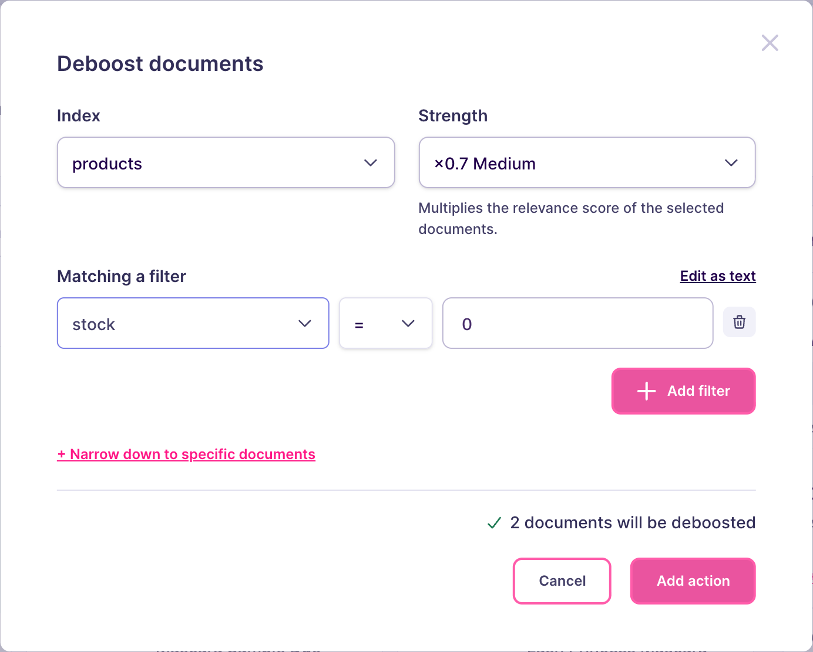

import CodeSamplesSearchRulesGuideDeboost1 from '/snippets/generated-code-samples/code_samples_search_rules_guide_deboost_1.mdx';

Out-of-stock products frustrate shoppers when they fill the first results, but removing them hurts too: users still search for them, and they come back in stock. The same applies to refurbished items, old article versions, or listings from sellers with poor ratings. Deboosting keeps these documents findable and moves them after the others.

One rule with a deboost action covers this, and no condition is needed if you want it to apply to every search.

## Set up from the Meilisearch Cloud dashboard

Open your project in the [Meilisearch Cloud dashboard](https://cloud.meilisearch.com), select the **Search rules** tab, and click **New rule**. The visual editor opens. For a walkthrough of the editor, see [Create your first rule](/capabilities/search_rules/create_your_first_rule).

Choose the index, here `products`. In the **Your rule** panel, keep **Anything** selected, so the rule applies to every search.

Hover any result card, click its deboost icon, then click **Choose a filter…**. Fill in the dialog:

- **Index**: the index holding the products, here `products`.
- **Strength**: how far the selected products drop. Start with **Medium**, then run a few searches of your own and adjust: the right strength depends on your data and on the way your users search.
- **Matching a filter**: the condition selecting the products, here `stock = 0`. The attribute you filter on must be in the [`filterableAttributes` setting](/reference/api/settings/get-filterableattributes) of the index, otherwise the action selects no document.

The dialog tells you how many documents the action affects. Click **Add action**.



Click **Save rule**. In the **Review and save** dialog, name the rule, such as `out-of-stock-last`, then click **Save and activate**. Meilisearch indexes the rule, which can take a few seconds to a few minutes. Once it is live, out-of-stock products remain findable, but they lose ground to the products you can ship.

## Set up on a self-hosted instance

<Warning>
Turn on Search Rules before you call the `/dynamic-search-rules` routes, otherwise Meilisearch returns an error. See [Create your first rule](/capabilities/search_rules/create_your_first_rule#turn-on-search-rules-2).
</Warning>

<CodeSamplesSearchRulesGuideDeboost1 />

- `weight` multiplies the relevancy of the selected documents. Between `0` and `1`, the documents rank lower. The closer to `0`, the further down they go.
- Deboosted documents stay in the results and in the facet counts. Only their position changes.
- A rule without `conditions` applies to every search on the index.
- The attributes used in `filter` must be in the [`filterableAttributes` setting](/reference/api/settings/get-filterableattributes) of the index, otherwise the action selects nothing.

Meilisearch answers with a summarized task containing a `taskUid`, because creating a rule is an [asynchronous operation](/capabilities/indexing/tasks_and_batches/async_operations):

```json
{
  "taskUid": 43,
  "indexUid": ".meili_dsr",
  "status": "enqueued",
  "type": "dsrUpdate",
  "enqueuedAt": "2026-05-28T09:31:12.378140260Z"
}
```

The rule applies to searches once this task reaches the `succeeded` status. To follow its progress, pass the `taskUid` to the [task API](/reference/api/tasks/get-task).

From then on, out-of-stock products lose ground to the ones you can ship, and customers still find them. They do not always fall to the bottom: a product that matches the query much better than the others can still come first. Check a few typical searches and lower the weight if you want a stronger effect.

## Next steps

<CardGroup cols={2}>
  <Card title="Hide documents" href="/capabilities/search_rules/how_to/hide_documents">
    Remove documents from the results instead of lowering them
  </Card>
  <Card title="Boost documents" href="/capabilities/search_rules/how_to/boost_documents">
    Rank a selection of documents higher
  </Card>
  <Card title="Specific behaviors" href="/capabilities/search_rules/advanced/specific_behaviors">
    See how actions interact with filters and with each other
  </Card>
  <Card title="API reference" href="/reference/api/search-rules/create-or-update-a-search-rule">
    Endpoints, rule fields, and update behavior
  </Card>
</CardGroup>
