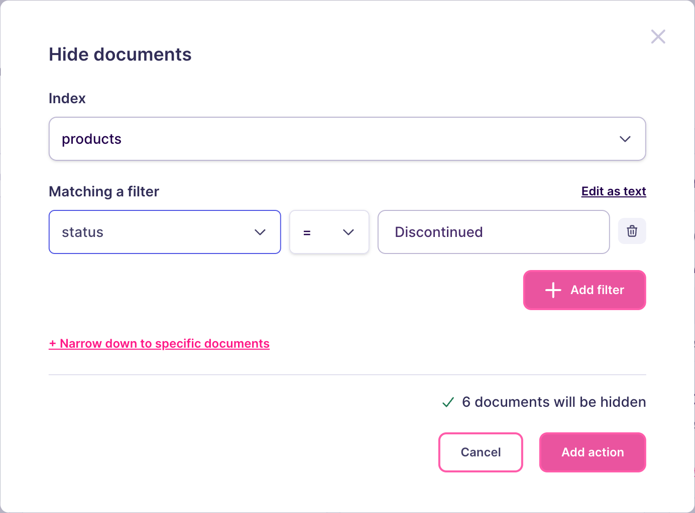

import CodeSamplesSearchRulesGuideHide1 from '/snippets/generated-code-samples/code_samples_search_rules_guide_hide_1.mdx';

You stop selling a product, but you keep it in your index: order history, direct links, and your analytics still need it. It should simply disappear from search. The same need comes up with archived help articles, or with a document you must take down immediately after a complaint.

Hiding solves this in one rule, and takes effect without reindexing your documents.

## Set up from the Meilisearch Cloud dashboard

Open your project in the [Meilisearch Cloud dashboard](https://cloud.meilisearch.com), select the **Search rules** tab, and click **New rule**. The visual editor opens. For a walkthrough of the editor, see [Create your first rule](/capabilities/search_rules/create_your_first_rule).

Choose the index, here `products`. In the **Your rule** panel, keep **Anything** selected, so the rule applies to every search.

Hover a result card, then click its hide icon. To hide only the document on the card, select **This document only**. To hide a whole set of documents at once, click **Choose a filter…**, then fill in the dialog:

- **Index**: the index holding the documents, here `products`.
- **Matching a filter**: the condition selecting them, here `status = Discontinued`. The attribute you filter on must be in the [`filterableAttributes` setting](/reference/api/settings/get-filterableattributes) of the index, otherwise the action selects no document.

The dialog tells you how many documents disappear from the results. Click **Add action**.



In the preview, hidden documents appear faded after the other results, so you can check what your users no longer see.

Click **Save rule**. In the **Review and save** dialog, name the rule, such as `hide-discontinued`, then click **Save and activate**. Meilisearch indexes the rule, which can take a few seconds to a few minutes. Once it is live, the discontinued products no longer appear in any search, and nothing was removed from your index. To bring them back, pause the rule or delete it.

## Set up on a self-hosted instance

<Warning>
Turn on Search Rules before you call the `/dynamic-search-rules` routes, otherwise Meilisearch returns an error. See [Create your first rule](/capabilities/search_rules/create_your_first_rule#turn-on-search-rules-2).
</Warning>

<CodeSamplesSearchRulesGuideHide1 />

- Hiding is a `scale` action with a `weight` of `0`.
- Hidden documents leave the results and the facet counts, but they stay in your index. You can still retrieve them with the documents endpoints.
- If another rule pins a hidden document, the document is pinned. See [specific behaviors](/capabilities/search_rules/advanced/specific_behaviors).
- The attributes used in `filter` must be in the [`filterableAttributes` setting](/reference/api/settings/get-filterableattributes) of the index, otherwise the action selects nothing.

Meilisearch answers with a summarized task containing a `taskUid`, because creating a rule is an [asynchronous operation](/capabilities/indexing/tasks_and_batches/async_operations):

```json
{
  "taskUid": 44,
  "indexUid": ".meili_dsr",
  "status": "enqueued",
  "type": "dsrUpdate",
  "enqueuedAt": "2026-05-28T09:42:08.427773885Z"
}
```

The rule applies to searches once this task reaches the `succeeded` status. To follow its progress, pass the `taskUid` to the [task API](/reference/api/tasks/get-task).

From then on, the discontinued products disappear from the results and from the facet counts, for every search and every user, while they stay in your index.

## Next steps

<CardGroup cols={2}>
  <Card title="Deboost documents" href="/capabilities/search_rules/how_to/deboost_documents">
    Lower documents instead of removing them
  </Card>
  <Card title="Boost documents" href="/capabilities/search_rules/how_to/boost_documents">
    Rank a selection of documents higher
  </Card>
  <Card title="Pause a rule" href="/capabilities/search_rules/how_to/pause_a_rule">
    Bring the hidden documents back
  </Card>
  <Card title="API reference" href="/reference/api/search-rules/create-or-update-a-search-rule">
    Endpoints, rule fields, and update behavior
  </Card>
</CardGroup>
