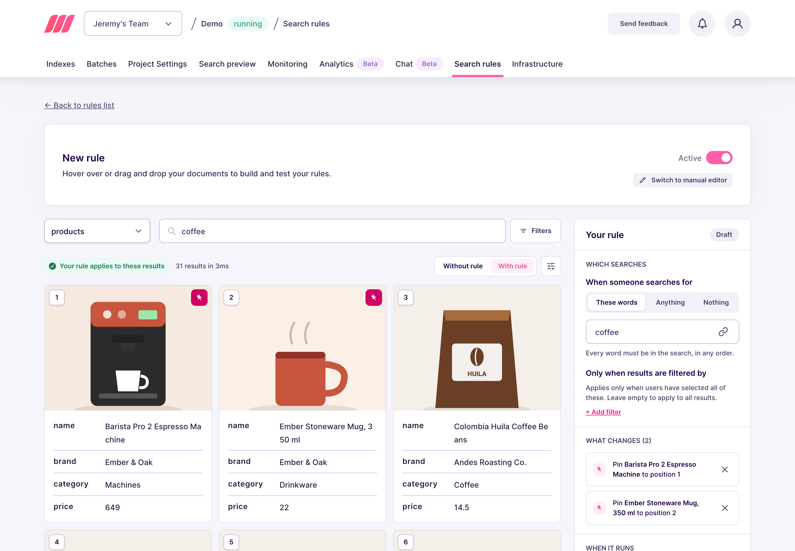

import CodeSamplesSearchRulesGuidePinMultiple1 from '/snippets/generated-code-samples/code_samples_search_rules_guide_pin_multiple_1.mdx';

When customers search for "coffee", you know what they should see first: the espresso machine you promote this month, then the mug that goes with it. One pin controls one position, so a rule with several pin actions builds the top of your results in the order you choose. Organic results fill everything below.

## Set up from the Meilisearch Cloud dashboard

Open your project in the [Meilisearch Cloud dashboard](https://cloud.meilisearch.com), select the **Search rules** tab, and click **New rule**. The visual editor opens. For a walkthrough of the editor, see [Create your first rule](/capabilities/search_rules/create_your_first_rule).

### Choose when the rule applies

Choose the index, here `products`. In the **Your rule** panel, select **These words**, then type `coffee` in the search bar. The rule now applies to every search containing that word, in any order, so it also covers "coffee machine" or "best coffee grinder".

### Pin the documents

To pin a document near the top, drag its card onto the position you want. For a document further down the results, hover its card and click the pin icon, then click the pin again and enter its new position in **Move to position**.

Pin the espresso machine at position `1`, then the coffee mug at position `2`. Each pinned card shows a filled pin, and the **What changes** section of the panel lists your pins in order.



Pins do not have to follow each other. Pinning at positions `1` and `5` leaves organic results in between.

### Save the rule

Click **Save rule**. In the **Review and save** dialog, name the rule, such as `coffee-top-picks`, then click **Save and activate**. Meilisearch indexes the rule, which can take a few seconds to a few minutes. Once it is live, a search containing "coffee" starts with your two picks, in the order you chose.

## Set up on a self-hosted instance

<Warning>
Search rules must be turned on before you call the `/dynamic-search-rules` routes, otherwise Meilisearch returns an error. See [Create your first rule](/capabilities/search_rules/create_your_first_rule#turn-on-search-rules-2).
</Warning>

<CodeSamplesSearchRulesGuidePinMultiple1 />

- Each entry in `pin` places one document at one position. The order of the entries does not matter, the `position` values do.
- Positions count from `0` in the API, so `0` is the first result. The dashboard displays the same slot as position `1`.
- If the current search filters exclude a pinned document, Meilisearch drops that pin and an organic result takes the slot. The other pins stay where you put them. See [specific behaviors](/capabilities/search_rules/advanced/specific_behaviors).

Meilisearch answers with a summarized task containing a `taskUid`, because creating a rule is an [asynchronous operation](/capabilities/indexing/tasks_and_batches/async_operations):

```json
{
  "taskUid": 46,
  "indexUid": ".meili_dsr",
  "status": "enqueued",
  "type": "dsrUpdate",
  "enqueuedAt": "2026-05-28T09:12:41.157267963Z"
}
```

The rule applies to searches once this task reaches the `succeeded` status. To follow its progress, pass the `taskUid` to the [task API](/reference/api/tasks/get-task).

From then on, every search containing "coffee" starts with your two picks, in the order you chose, and the organic results follow.

## Next steps

<CardGroup cols={2}>
  <Card title="Boost documents" href="/capabilities/search_rules/how_to/boost_documents">
    Rank a selection of documents higher during a campaign
  </Card>
  <Card title="Hide documents" href="/capabilities/search_rules/how_to/hide_documents">
    Remove documents from the results without reindexing
  </Card>
  <Card title="Specific behaviors" href="/capabilities/search_rules/advanced/specific_behaviors">
    See how pins interact with filters and with the other actions
  </Card>
  <Card title="API reference" href="/reference/api/search-rules/create-or-update-a-search-rule">
    Endpoints, rule fields, and update behavior
  </Card>
</CardGroup>
